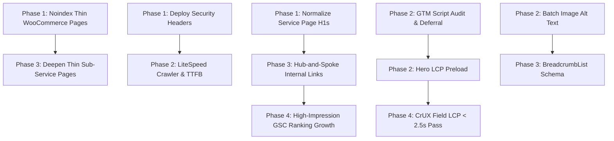

# Prioritized SEO Action Plan: nouvelleworkz.com

**Domain:** nouvelleworkz.com  
**Audit Date:** 2026-09-14  
**SEO Health Score:** 78 / 100 (Grade: B+)  
**Synthesis Framework:** 10-Principle Synthesis (PERCEIVE → ANALYZE → VALIDATE → ACT)

---

## Strategic Overview & Dependency Graph

---

## Phase 1: Critical Fixes & Crawl Hygiene (Week 1)

### 1.1 Remove Vestigial WooCommerce Utility Pages from Index
- **First Principle (THINK):** Empty utility pages dilute domain authority and waste crawl budget on search engines.
- **Action:** Set `noindex,follow` on `/cart/`, `/checkout/`, `/my-account/`, and `/shop/`. Exclude these URLs from `page-sitemap.xml`.
- **System Dependency (CONNECT):** Unblocks clean crawl budget allocation for high-priority commercial and residential hubs.
- **Falsifiability Check (ACCEPT):** If Google Indexing API / URL Inspection still reports "Submitted and indexed" on `/checkout/` after 14 days, the rewrite rule failed.
- **Leading Indicator (GROW):** GSC Coverage report shows pages transitioned to "Excluded by 'noindex' tag" with zero 404 errors.
- **Effort / Impact:** Low Effort / High Impact

### 1.2 Deploy HTTP Security Headers in `.htaccess`
- **First Principle (THINK):** Modern HTTPS sites require explicit browser transport and MIME-sniffing protection for trust and performance scoring.
- **Action:** Add `Strict-Transport-Security`, `X-Content-Type-Options: nosniff`, and `Cross-Origin-Opener-Policy` to server headers.
- **System Dependency (CONNECT):** Foundation for clean security score and eliminates Lighthouse security warnings.
- **Falsifiability Check (ACCEPT):** Running `curl -I https://nouvelleworkz.com/` must return `Strict-Transport-Security: max-age=31536000; includeSubDomains; preload`.
- **Leading Indicator (GROW):** Security score in automated audits reaches 100/100.
- **Effort / Impact:** Low Effort / Medium Impact

### 1.3 Correct Multiple H1 Heading Defects on Key Service Pages
- **First Principle (THINK):** An HTML document should communicate a single, unambiguous primary topic to crawlers via a single `<h1>` element.
- **Action:** Update Elementor page templates for `/commercial/salon-retail-shop-renovation/`, `/commercial/fb-cafe-renovation/`, and `/residential/condo-renovation/` to ensure only the page title is wrapped in `<h1>`. Demote secondary banner headings to `<h2>` or `
`.
- **System Dependency (CONNECT):** Establishes correct topical hierarchy before internal links are built.
- **Falsifiability Check (ACCEPT):** DOM inspection confirms `document.querySelectorAll('h1').length === 1` on all service landing pages.
- **Leading Indicator (GROW):** Improved rankings for primary service intent keywords in GSC.
- **Effort / Impact:** Low Effort / High Impact

---

## Phase 2: High-Impact Performance & Speed (Weeks 2-3)

### 2.1 Audit & Consolidate Google Tag Manager Scripts
- **First Principle (THINK):** 666 KB of synchronous tracking scripts executing for 907 ms on the main thread is the #1 cause of poor mobile performance (TBT 870ms, Score 41).
- **Action:** Audit the GTM container (`GTM-TSVDC6W5`). Remove obsolete duplicate tags (`G-T2DTRL7NCL`, `G-RK8J0RWZ65`, `AW-18122083496`). Defer third-party marketing tags until after initial DOM rendering using `requestIdleCallback` or LiteSpeed Delay JS.
- **System Dependency (CONNECT):** Directly reduces Total Blocking Time and unlocks 70+ Mobile Lighthouse score.
- **Falsifiability Check (ACCEPT):** Lighthouse mobile TBT drops below 300 ms on repeat runs.
- **Leading Indicator (GROW):** CrUX field INP remains firmly < 50 ms and user engagement rate improves.
- **Effort / Impact:** Medium Effort / Critical Impact

### 2.2 Preload Hero LCP Image & Set Fetch Priority
- **First Principle (THINK):** Mobile LCP is 4.5s lab and 2,999ms CrUX field because the above-the-fold hero background is discovered late by the browser parser.
- **Action:** Inject `<link rel="preload" as="image" href="[hero_url]" fetchpriority="high">` in the document `<head>` and ensure images are sized responsively.
- **System Dependency (CONNECT):** Directly cuts LCP element render delay.
- **Falsifiability Check (ACCEPT):** Mobile LCP lab score drops under 2.5s in PageSpeed Insights.
- **Leading Indicator (GROW):** CrUX 28-day p75 LCP moves from "Needs Improvement" (2,999ms) to "Good" (< 2,500ms).
- **Effort / Impact:** Low Effort / High Impact

### 2.3 Activate LiteSpeed Cache Crawler & Warmup
- **First Principle (THINK):** Real user TTFB is 2,646ms because non-cached dynamic requests hit cold PHP scripts.
- **Action:** Enable the LiteSpeed Cache crawler with a cron job to keep all 118 sitemap URLs permanently warmed in the server cache.
- **System Dependency (CONNECT):** Ensures all first-time visitors receive the ~16ms static cache response.
- **Falsifiability Check (ACCEPT):** Server response headers show `X-Litespeed-Cache: hit` on cold browser requests.
- **Leading Indicator (GROW):** CrUX TTFB trend turns downward toward the < 800ms green threshold.
- **Effort / Impact:** Low Effort / High Impact

### 2.4 Batch Update Image Alt Text
- **First Principle (THINK):** Over 64% of images (553 of 864) either lack alt text or contain meaningless raw timestamps (e.g. `_1786439745102`).
- **Action:** Apply the generated alt text proposals across media library items with descriptive keywords (e.g., "4-room HDB BTO bespoke carpentry kitchen cabinet installation Singapore").
- **System Dependency (CONNECT):** Enhances accessibility and Google Image Search discoverability.
- **Falsifiability Check (ACCEPT):** Media library audit confirms 0 images with empty or timestamp-like alt text.
- **Leading Indicator (GROW):** Increase in Google Image Search impressions in Search Console.
- **Effort / Impact:** Medium Effort / Medium Impact

---

## Phase 3: Content Expansion & Authority (Month 2)

### 3.1 Expand Thin Sub-Service Landing Pages
- **First Principle (THINK):** Pages with <300 words cannot effectively satisfy transactional commercial search intent.
- **Action:** Expand `/residential/ceiling-partition/` (260 words), `/residential/painting/` (212 words), and `/residential/plastering/` (191 words) to 600-800 words. Add material specs, Singapore pricing tables ($/sqft), regulatory safety notices, and client FAQs.
- **System Dependency (CONNECT):** Transforms thin pages into linkable service nodes.
- **Falsifiability Check (ACCEPT):** Word count verification confirms all service pages exceed 500 words.
- **Leading Indicator (GROW):** Keyword rankings for "ceiling partition singapore" and "hdb painting contractor" move onto Page 1.
- **Effort / Impact:** Medium Effort / High Impact

### 3.2 Implement BreadcrumbList Structured Data Sitewide
- **First Principle (THINK):** Breadcrumbs clarify site hierarchy to Google and improve SERP click-through rates.
- **Action:** Deploy dynamic `BreadcrumbList` JSON-LD schema across all subpages and blog posts.
- **System Dependency (CONNECT):** Complements the existing `LocalBusiness` and `Person` schema.
- **Falsifiability Check (ACCEPT):** Google Rich Results Test validates Breadcrumb structured data on deep post URLs.
- **Leading Indicator (GROW):** SERP snippets show structured navigation pathways.
- **Effort / Impact:** Low Effort / Medium Impact

### 3.3 Hub-and-Spoke Internal Link Building
- **First Principle (THINK):** 30 articles currently have 0 contextual internal links originating from related cluster pages.
- **Action:** Link informational blog posts (e.g., BTO schedules, kitchen yard wall hacking) directly into corresponding commercial and residential service hubs.
- **System Dependency (CONNECT):** Passes PageRank from high-ranking informational blogs to commercial conversion landing pages.
- **Falsifiability Check (ACCEPT):** Internal link crawler reports zero orphaned or single-link cluster pages.
- **Leading Indicator (GROW):** Higher organic conversion rate on service landing pages.
- **Effort / Impact:** Medium Effort / High Impact

---

## Phase 4: Monitoring, GEO Tracking & Iteration (Ongoing)

### 4.1 Monitor CrUX Field Data & Web Vitals History
- Track CrUX 28-day p75 metrics weekly to ensure LCP stays < 2.5s, CLS < 0.1, and TTFB < 800ms.

### 4.2 Capitalize on GSC High-Impression Quick Wins
- Monitor and refine title tags for queries currently hovering in positions 4-10:
  - `nouvelle workz pte ltd reviews` (Pos 6.4 | 130 impr)
  - `l box ceiling` (Pos 8.6 | 97 impr)
  - `electrical rewiring cost singapore` (Pos 9.1 | 62 impr)

### 4.3 Maintain `llms.txt` and AI Citability Standards
- Update `llms.txt` bi-annually with verified project completions, licensing renewals, and updated 2026/2027 market price references.

### 4.4 Backlink & Scraper Hygiene
- Monitor GSC referring domains monthly to disavow malicious scraper patterns (e.g., `kompromat100.info`).
